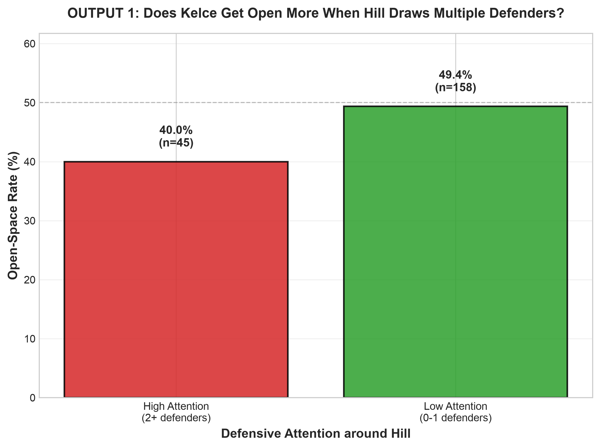

# The Tyreek Hill Effect: Does Hill's Defensive Attention Help Travis Kelce Get Open?

**NFL Big Data Bowl, NYU Edition** · 2021 Kansas City Chiefs, Weeks 1–8 · 203 passing plays



## Summary (what we built, what we found, who it's for)

We built a **defensive gravity metric**. It counts the coverage defenders within 5 yards of Tyreek Hill 1.5 seconds after the snap, then checks whether Travis Kelce has more space when Hill draws that attention. **The gravity hypothesis was not supported.** When Hill had 2+ defenders nearby, Kelce was open (3+ yards of separation) on **40.0%** of plays, against **49.4%** when Hill had 0–1. The correlation was weak and not significant (Spearman ρ = −0.08, p = 0.27). What actually predicted Kelce's space was **coverage scheme**: about **3.3–3.6 yards** of separation against zone, but only **1.6–2.0 yards** against man, whatever was happening around Hill. Coaches, scouts and broadcasters can use this. These are associations from tracking data, not proof of cause and effect.

## Why this matters

Box-score stats only credit the player who catches the ball. A common belief is that a star like Hill "pulls" defenders and opens space for teammates, the way Messi draws two defenders in soccer. We tested that belief with player tracking data.

- **Coaches:** with this Chiefs offense, double attention on Hill didn't free up Kelce. Kelce's space comes from facing zone coverage, so the useful lever is calling plays that beat or force zone.
- **Scouts:** a tight end's separation depends heavily on the defensive scheme. Compare TEs within the same coverage type, or the comparison is misleading.
- **Broadcasters:** "Against zone, Kelce finds 3–4 yards of space. Against man, it's under 2, no matter what's happening around Tyreek Hill."

## Key results

| Question | High attention on Hill (2+ defenders) | Low attention (0–1) | Result |
|---|---|---|---|
| How often is Kelce open (≥ 3 yd)? | 40.0% (18/45) | 49.4% (78/158) | −9.4 pts, Kelce is open *less* often |
| Kelce's separation change, snap to 1.5 s | −1.75 yd | −1.87 yd | Basically the same; defenders close in on him either way |
| Kelce's average separation at 1.5 s | 2.64 yd | 3.24 yd | ρ = −0.08, p = 0.27 (not significant) |
| **Man coverage:** Kelce separation | 2.01 yd (n = 21) | 1.61 yd (n = 29) | Tight either way |
| **Zone coverage:** Kelce separation | 3.27 yd (n = 19) | 3.63 yd (n = 124) | Loose either way |

How often Hill drew attention, across 236 plays: he had 2+ nearby defenders on about **24%** of plays. The most common case was exactly 1 defender (140 plays).

More charts are in `outputs/`:
- `output2_separation_gain.png`: how Kelce's separation changes between the snap and 1.5 s
- `output3_attention_relationship.png`: attention on Hill vs Kelce's space
- `output4_man_vs_zone.png`: the coverage-scheme split
- `metric1_*.png`, `metric2_*.png`, `metric3_*.png`: details for each metric

## Method

1. **Data:** the provided NFL Next Gen Stats tracking data (10 frames/second) plus PFF scouting data. We kept Chiefs offensive plays where **Hill (nflId 43454) and Kelce (nflId 40011) both ran a route** (238 plays). Plays where a 1.5 s snapshot wasn't possible were dropped, leaving **203 plays** in the final analysis.
2. **Normalization:** coordinates are flipped so the offense always moves left to right.
3. **Coverage defenders:** defenders with PFF role `Coverage`. Pass rushers are excluded.
4. **Metric 1, Defensive Attention:** the number of coverage defenders within 5 yards of Hill at 1.5 s after the snap (snap + 15 frames). 2+ counts as "high," 0–1 as "low."
5. **Metric 2, Kelce's Space:** the Euclidean distance from Kelce to his nearest coverage defender, at the snap and at 1.5 s. "Open" means 3 yards or more.
6. **Metric 3, Gravity–Space Relationship:** high vs low attention compared overall and separately for man and zone (PFF `pff_passCoverageType`). Tests used: Spearman correlation, Mann-Whitney U, bootstrap 95% confidence intervals, and OLS controlling for coverage type.

We measure at 1.5 s rather than at the throw so that every play is compared at the same point in its development.

## Assumptions and limitations

- **Nearby isn't the same as assigned.** The data doesn't say which defender is covering whom, so "attention" means defenders close to Hill, who may be covering a zone or someone else.
- **Separation isn't the same as open.** Three yards of space can still be a bad throw because of leverage or a blocked passing lane.
- **This is association, not causation.** Scheme probably drives both measurements: man coverage puts defenders close to Hill *and* to Kelce.
- **Small subgroups.** The high-attention groups split by coverage have only n = 19–21, so those differences are not reliable.
- **One team, 8 games, fixed thresholds.** The 5-yard radius and 3-yard "open" cutoff are judgment calls, and the results may not generalize beyond the 2021 Chiefs.

## How to run

```bash
pip install -r requirements.txt

# 1. Get the source data (~826 MB, not committed)
git clone --depth 1 https://github.com/ThompsonJamesBliss/nfl-big-data-bowl-regional-event-data data/raw/source

# 2. Build the processed datasets (run from the repo root)
python src/prepare_data.py

# 3. Compute the metrics and outputs
python src/metric1_defensive_attention.py
python src/metric2_kelce_separation.py
python src/metric3_gravity_space_relationship.py
python src/final_outputs_analysis.py
python src/visualize_metrics.py
```

The processed data and all output charts are already committed, so you can read the results without running anything.

## Repository layout

```
src/
  prepare_data.py                       # filter KC plays, normalize direction, build snapshots
  metric1_defensive_attention.py        # defenders within 5 yd of Hill
  metric2_kelce_separation.py           # Kelce's nearest-defender distance over time
  metric3_gravity_space_relationship.py # stats: Hill attention vs Kelce space
  final_outputs_analysis.py             # merge metrics, produce the 4 outputs
  visualize_metrics.py                  # metric charts
data/processed/                         # kc_plays, kc_snapshots, metric CSVs, DATA_NOTES.md
outputs/                                # charts, FINDINGS_REPORT.md, PROJECT_SUMMARY.md
```

Full write-ups: [`outputs/FINDINGS_REPORT.md`](outputs/FINDINGS_REPORT.md) and [`outputs/PROJECT_SUMMARY.md`](outputs/PROJECT_SUMMARY.md). Data details and validation checks: [`data/processed/DATA_NOTES.md`](data/processed/DATA_NOTES.md).
