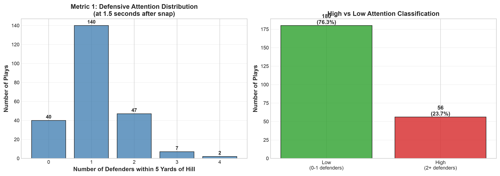
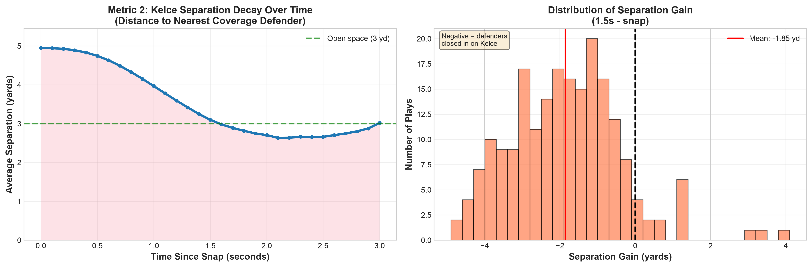
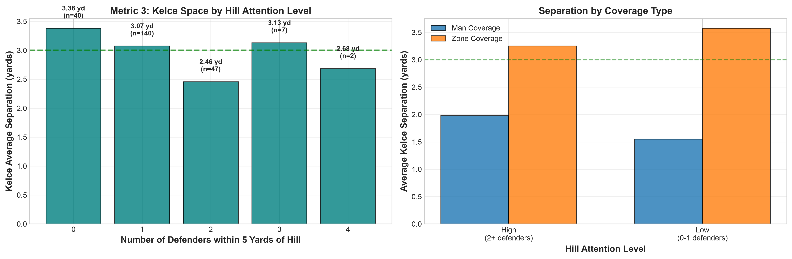
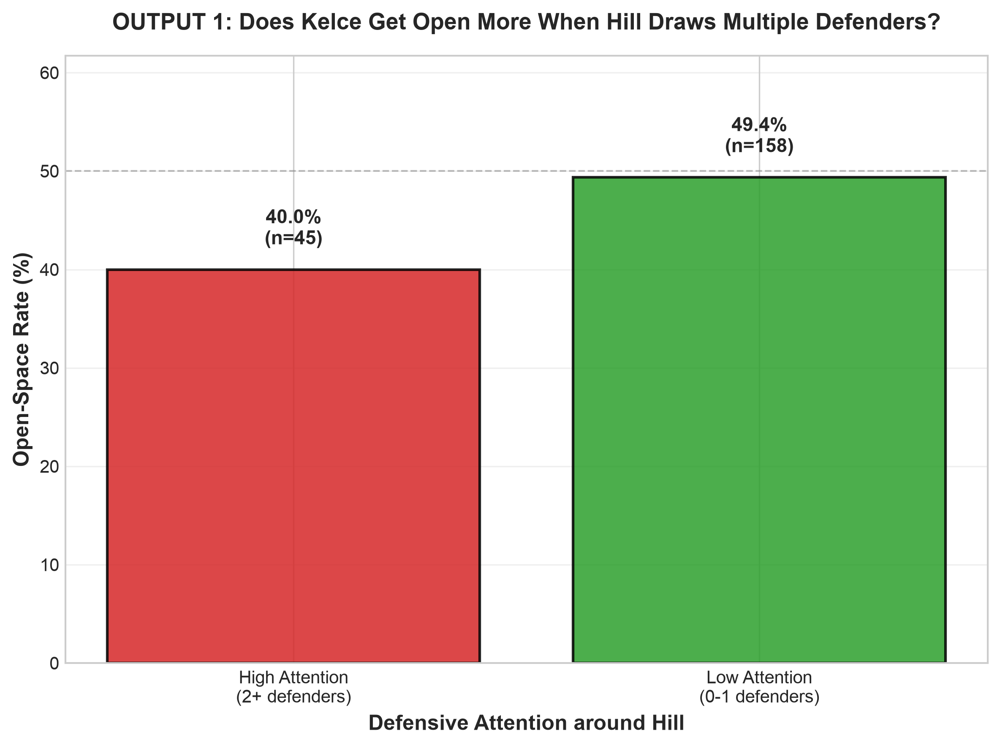
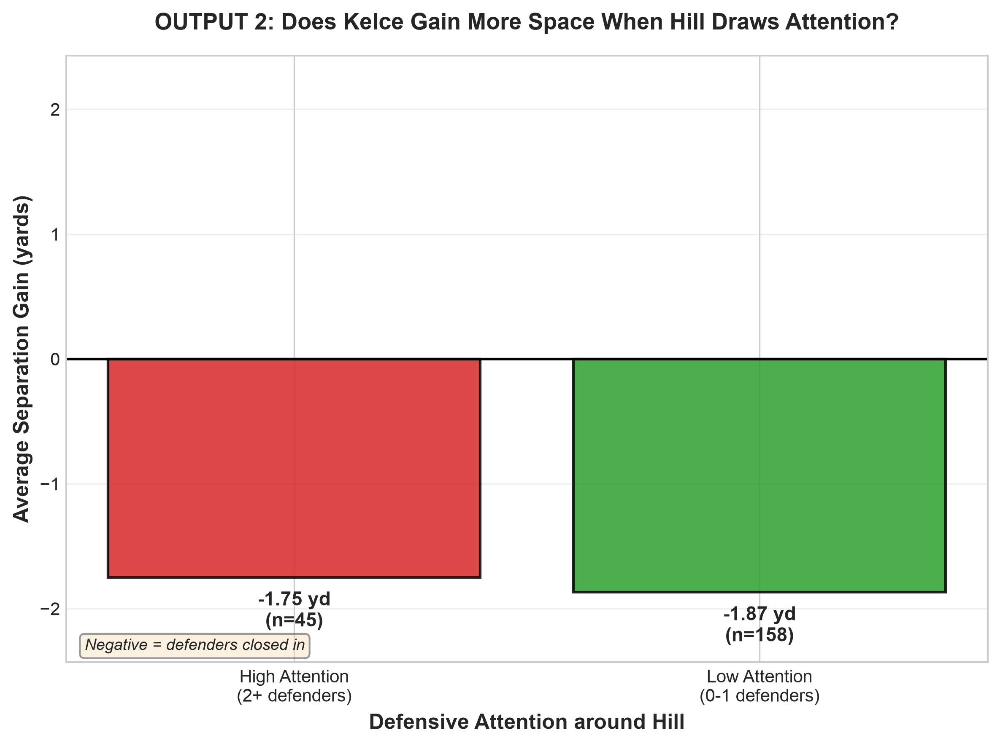
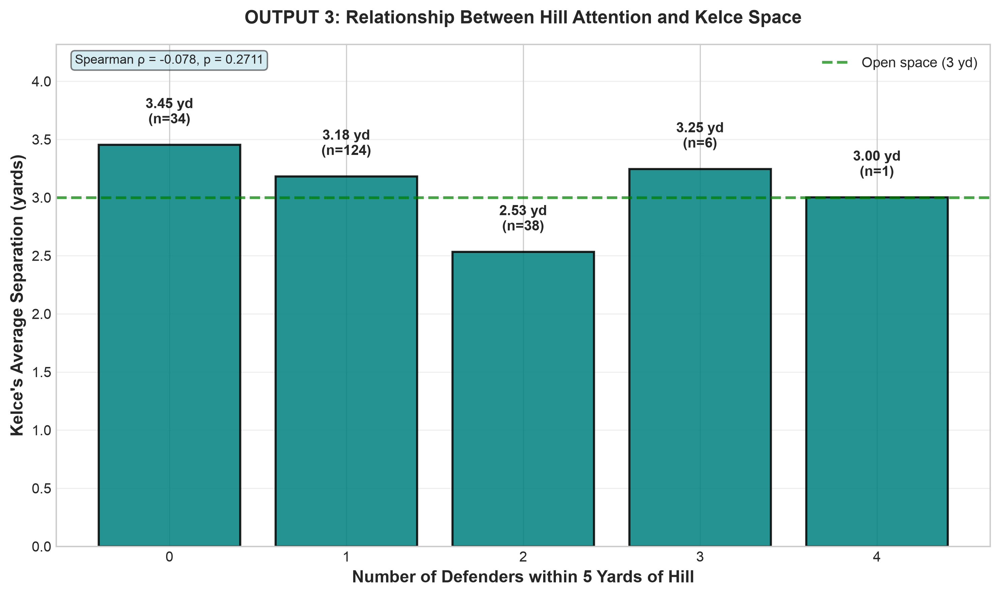
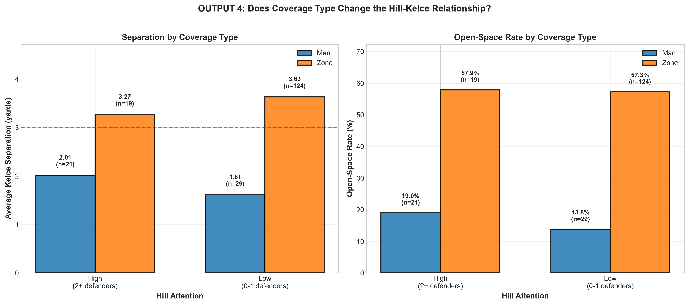

# The Hidden Space: Testing Tyreek Hill's Defensive Gravity

**NFL Big Data Bowl — NYU Edition (2026)**  
**Research question:** Does defensive attention around Tyreek Hill correspond to more space for Travis Kelce, and does that relationship change under man and zone coverage?

## The short answer

We expected Kelce to have more room when multiple defenders were close to Hill. **That was not the pattern in our data.** On the 203 plays used in the final comparison, Kelce averaged **2.64 yards** of separation when Hill had two or more nearby coverage defenders, versus **3.24 yards** when Hill had zero or one. But the comparison changes when we separate **man** and **zone** coverage: Kelce generally had much more space against zone, and the Hill-attention differences within each coverage type were small and uncertain.

**Main takeaway:** In this sample, *the type of coverage was more closely related to Kelce's available space than the number of defenders near Hill*. We cannot claim either factor caused that space.

## Data and method

We studied the **2021 Kansas City Chiefs, Weeks 1–8**, using NFL player-tracking data and PFF scouting information. We focused on plays where Tyreek Hill and Travis Kelce both ran pass routes.

- Player positions are recorded **10 times per second**. Our main measurement is **1.5 seconds after the snap**, before the pass or play-ending event.
- **Metric 1** has **236** valid 1.5-second plays; **Metric 2** has **204** pass-play separation-gain records; **Metric 3** has **236** valid plays.
- The final report uses the **203 plays shared by all three metrics**, so the output charts compare the same plays. The other Metric 2 record was thrown before 1.5 seconds and has no valid pre-throw snapshot at that moment.
- In the final sample, **45 plays** had high Hill attention and **158** had low Hill attention.
- We matched records on **gameId + playId**, checked for duplicate plays and missing values, and confirmed that Metric 2 and Metric 3 separation values agree to rounding.
- **High attention** means **at least 2 coverage defenders within 5 yards of Hill**. **Low attention** means **0–1**.
- **Open space** means Kelce is **at least 3 yards from his nearest coverage defender**. This is a measurement rule, not a guarantee that a pass is possible.

The provided tracking coordinates are already oriented in the same direction. Distance is calculated from the players' x/y positions on the field.

## Our three metrics

### Metric 1 — Defensive Attention: How crowded is it around Hill?

We counted **unique coverage defenders within 5 yards of Tyreek Hill** at 1.5 seconds.

Across the **236 plays available to Metric 1**, Hill had:
- **0 nearby defenders:** 40 plays
- **1 nearby defender:** 140 plays
- **2 nearby defenders:** 47 plays
- **3 nearby defenders:** 7 plays
- **4 nearby defenders:** 2 plays

That gives **56 high-attention plays (23.7%)** and **180 low-attention plays (76.3%)** in Metric 1's full sample. For the **203 shared plays**, the counts are **45 high** and **158 low**.

**What it means:** Multiple coverage defenders were not usually within five yards of Hill at this exact moment. But *nearby* does not mean the defenders were assigned to Hill or were deliberately double-teaming him.

### Metric 2 — Space Exploitation: How much room does Kelce create or lose?

We measured Kelce's distance to his **nearest coverage defender** at the snap and 1.5 seconds later.

**Separation gain = separation at 1.5 seconds − separation at the snap.**

In our **203-play final sample**:
- Average separation **at the snap: 4.95 yards**
- Average separation **at 1.5 seconds: 3.11 yards**
- Average change: approximately **−1.84 yards**
- Kelce gained separation on only **15 of 203 plays (7.4%)** by this snap-to-1.5-second measure.

**What it means:** The distance to his nearest coverage defender usually got smaller during the opening 1.5 seconds. That does not mean Kelce ran a bad route: he may start with space because defenders initially line up away from him, and that space can narrow as the play develops.

### Metric 3 — Defensive Gravity Relationship: Does attention around Hill line up with more room for Kelce?

We connected Metric 1's defender count to Kelce's separation at **the same 1.5-second moment**.

In the **203-play final sample**:
- **High Hill attention:** Kelce averaged **2.64 yards** separation (45 plays).
- **Low Hill attention:** Kelce averaged **3.24 yards** separation (158 plays).
- **Difference:** **−0.60 yards** (high minus low).
- **Spearman correlation:** **ρ ≈ −0.08, p ≈ 0.27**. That is a very weak overall relationship.

**What it means:** We did not find a clear, consistent pattern that having more defenders near Hill gives Kelce more space. The differences also depend on what defensive coverage is being played.

## Four final outputs

All four outputs below use the **same 203 plays**.

### Output 1 — Open-Space Rate

**Question:** Is Kelce at least 3 yards from his nearest defender more often when Hill has multiple defenders nearby?

| Hill attention | Plays with 3+ yards separation | Open-space rate |
|---|---:|---:|
| High (2+ defenders) | 18 / 45 | **40.0%** |
| Low (0–1 defender) | 78 / 158 | **49.4%** |

**Difference: −9.4 percentage points.** The 95% bootstrap confidence interval for the difference was approximately **−25.5 to +7.1 percentage points**, and Fisher's exact test gave **p ≈ 0.31**. We **cannot confidently say** that the open-space rates differ.

**Plain-English takeaway:** Kelce met our 3-yard rule less often when Hill had more defenders nearby, but the evidence is not strong enough to call that a reliable pattern.

### Output 2 — Average Separation Gain

**Question:** Does Kelce gain more space during the first 1.5 seconds when more defenders are near Hill?

| Hill attention | Average separation gain | Plays with positive gain |
|---|---:|---:|
| High (45 plays) | **−1.75 yards** | 1 / 45 (**2.2%**) |
| Low (158 plays) | **−1.87 yards** | 14 / 158 (**8.9%**) |

**Difference: +0.12 yards.** The 95% bootstrap interval was approximately **−0.28 to +0.50 yards** (Mann–Whitney **p ≈ 0.28**).

**Plain-English takeaway:** Kelce typically **lost separation in both groups**, and the small difference between groups could easily be ordinary variation.

### Output 3 — Defensive Attention Relationship

**Question:** Does Kelce's separation steadily increase as more defenders gather near Hill?

| Defenders within 5 yards of Hill | Plays | Kelce's average separation |
|---|---:|---:|
| 0 | 34 | **3.45 yards** |
| 1 | 124 | **3.18 yards** |
| 2 | 38 | **2.53 yards** |
| 3 or more | 7 | **3.21 yards** |

Spearman **ρ ≈ −0.08 (p ≈ 0.27)**. The final group has just **7 plays**, so that bar is especially uncertain. The overall high-minus-low mean difference was **−0.60 yards**; the percentile bootstrap interval was about **−1.18 to −0.01 yards**, while the Mann–Whitney test gave **p ≈ 0.13**. These methods test different summaries and do not give a strong, consistent case for a relationship; we should be especially cautious because plays from the same games are not fully independent.

**Plain-English takeaway:** There is no steady pattern showing that more nearby defenders around Hill means more space for Kelce.

### Output 4 — Man vs Zone Coverage: The clearest story

**Question:** Does the Hill–Kelce relationship look different depending on the defensive scheme?

| Coverage | Hill attention | Plays | Kelce average separation | Open-space rate |
|---|---|---:|---:|---:|
| Man | High | 21 | **2.01 yd** | 19.0% |
| Man | Low | 29 | **1.61 yd** | 13.8% |
| Zone | High | 19 | **3.27 yd** | 57.9% |
| Zone | Low | 124 | **3.63 yd** | 57.3% |

**10 plays labeled "Other"** are excluded from this man-vs-zone comparison.

- **Within man coverage:** High attention was linked with **+0.40 yards** more Kelce separation, but the difference was uncertain (**p ≈ 0.34**).
- **Within zone coverage:** High attention was linked with **−0.36 yards** less separation, also uncertain (**p ≈ 0.75**).
- **Across schemes:** Kelce averaged approximately **1.78 yards against man** versus **3.58 yards against zone** in this final sample. This larger difference is clearer than either Hill-attention comparison.

**Why the overall −0.60-yard difference can mislead:** The high-attention group contains a much larger share of man-coverage plays, where Kelce typically has less room. In the man and zone groups separately, the attention differences become smaller and even point in different directions. Coverage type explains much of the *apparent* overall gap; the data does **not** establish that coverage type *causes* it.

## What football professionals can learn

**For coaches:** Don't assume that two defenders near a star receiver automatically open space for another receiver. Look at the coverage scheme and where Kelce finds room. These results suggest that studying his routes against **zone coverage** may be more informative than relying on the nearby-defender count around Hill.

**For scouts:** A receiver's raw catches and yards do not tell the whole story, but our proximity-based metric alone is **not enough** to grade how much space a teammate creates. A better scouting tool would also consider routes, defender responsibilities, starting alignment, and the situation.

**For broadcasters:** *"We thought defenders crowding Tyreek Hill might leave Travis Kelce open. But in these Chiefs plays, Kelce generally had more room against zone coverage, no matter how many defenders were close to Hill."*

## Limits: What the data cannot prove

1. **Nearby does not mean assigned.** Our 5-yard radius is a simple way to count defenders, not proof of a double-team or deliberate attention.
2. **Three yards is not a guaranteed open pass.** We do not measure whether the quarterback has a safe throwing lane or whether Kelce was the target.
3. **This is not a cause-and-effect study.** Coverage, route design, field position, time to throw, and offensive strategy can all affect separation.
4. **Some groups are small.** For example, zone/high has 19 plays, man/high has 21, and the 3+ defender group has just 7.
5. **We studied one offense over eight weeks.** The pattern may differ for other players, teams, or seasons.
6. **The sample is selected.** Our final 203 plays require a pass and a valid 1.5-second pre-throw observation. Short plays, sacks, and scrambles are not represented in the same way.
7. **Some plays share a game or opponent.** Treating each play as fully independent can make uncertainty estimates too optimistic.

## Final conclusion

**Our original defensive-gravity hypothesis was not clearly supported.** When we looked at all 203 plays together, Kelce appeared to have less space when two or more defenders were near Hill. But much of that difference was tied to **which coverage scheme the defense used**. Kelce had noticeably more separation against **zone** than **man**, while the attention effect within either scheme was small and uncertain.

**The story to tell the judges:** *It's not just how many defenders are near Tyreek Hill. It's how the defense is set up around the whole play.*

## Where the work lives

**Repository:** https://github.com/rxd5484/nfl-big-data-ars-2026  
**Analysis branch:** `Data+Metrics`

**Code:** `src/metric1_defensive_attention.py`, `src/metric2_kelce_separation.py`, `src/metric3_gravity_space_relationship.py`, `src/final_outputs_analysis.py`, `src/visualize_metrics.py`.

**Data:** `data/processed/metric1_attention.csv`, `data/processed/metric2_separation_gain.csv`, `data/processed/metric3_gravity_space.csv`, `data/processed/final_analysis.csv`.

**Charts:** The three metric charts and four output charts are all in `outputs/`.

**To reproduce the four output charts:** Run `python src/final_outputs_analysis.py` from the repository root after installing dependencies. Run the metric scripts first only if their existing CSV outputs are missing.
